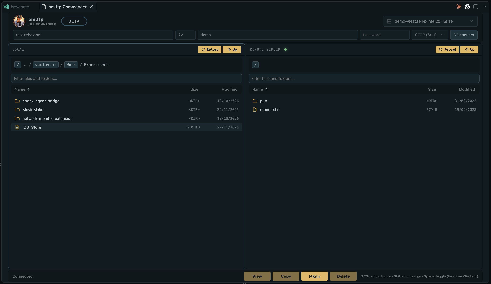

# bm.ftp — FTP Commander

A two-pane file manager for Visual Studio Code. Browse a local folder and a remote server side by side, then transfer files or complete directory trees without leaving the editor.



Project overview: [WESTBOHEMIA.COM](https://www.westbohemia.com/developer/bm.ftp.commander/)

## Features

- **FTP, explicit FTPS and SFTP over SSH.** Use plain FTP, encrypted explicit FTPS, or SFTP. FTP and FTPS default to port 21; SFTP defaults to port 22, and custom ports are supported.
- **Two-pane browsing.** View local and remote folders together. Navigate with clickable breadcrumbs, filter entries by name, and sort by columns. Folders appear before files.
- **Recursive transfers.** Copy selected files and directory trees between the local machine and server, including nested and empty directories. Transfer progress reports completed items and bytes; destination size checks help verify completion. Temporary files prevent incomplete transfers from appearing under their final names. The Commander asks before replacing an existing destination.
- **Read-only remote inspection.** Open remote files in VS Code without enabling edits to be written back to the server.
- **Mouse and keyboard selection.** Select multiple entries with Cmd/Ctrl-click, select a range with Shift-click, and toggle entries with Space or Insert on Windows.
- **Folder and file operations.** Create remote folders and delete selected files or folders after confirmation.
- **Saved connection profiles.** After a successful connection, the extension remembers the host, port, username and protocol. Failed connections are not saved. Choose a profile from the popup or remove it there with a confirmation.
- **SSH host-key verification.** On a new SFTP connection, review the SSH key algorithm and SHA256 fingerprint before trusting it. A changed key stops the connection until you explicitly verify and replace the saved key.

## How connections and credentials work

The connection bar accepts a server address, port, username, password and protocol. Successful connections can be saved as reusable profiles. Profile details are stored separately from passwords; passwords and trusted SSH host keys are stored with VS Code SecretStorage. A failed connection does not create a saved profile. While connected, the connection fields are disabled.

For SFTP, the first connection to a server displays its host-key algorithm and SHA256 fingerprint. Trust is saved only after you confirm the key and authentication succeeds. If the server presents a different key later, the extension stops and asks you to verify the replacement; cancelling keeps the previously trusted key.

## Development checks

Focused checks for SFTP and SSH host-key behavior:

```sh
npm run compile:extension
node --test test/sftpHostKeys.test.cjs test/sftpProtocolIntegration.test.cjs
npm run test:e2e -- --grep SFTP
```

## License

Free and open source under the MIT License.
