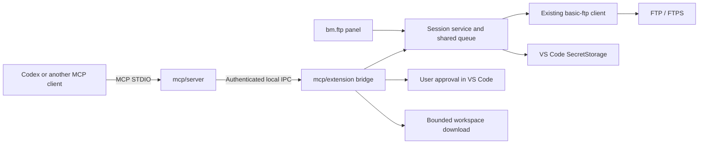

# bm.ftp MCP: solution design and technical implementation plan

Date: 17 October 2026. Status: implementation plan with an initial read-only provider in progress. See the [requirements and repository analysis](01-analysis.md) and [feasibility study](02-feasibility.md).

## 1. Architecture and transport



### Recommended approach: STDIO adapter and local IPC

The MCP server runs as a separate Node process started by the client. It implements only the tool catalog, schemas, and result mapping; it delegates operations over IPC to the extension host. The bridge exposes an explicit allowlist, not arbitrary calls into `CommanderPanel` or VS Code commands.

Use a Unix socket in a private directory on macOS/Linux and a named pipe on Windows. Store the runtime directory and discovery registry outside the repository, in a stable private location for the current OS user. Use POSIX directory permissions `0700` and registry file permissions `0600`; enforce equivalent DACL restrictions on Windows. A random pipe name alone is not access control.

Each window/extension host has a random `bridgeId`, its own socket, and a short-lived random token created only after the user enables MCP access. Authenticate before returning any session data. The token is not the FTP password, is not a tool argument, and is never written to the repository or chat output. The adapter reads it from a private runtime record. The bridge limits the token to the specific grant. Revoke the token and grant when MCP access is disabled, FTP is disconnected, or the profile changes.

Static Codex configuration contains only a stable launcher and the private discovery registry location, never a random `bridgeId` or token. When a user explicitly grants agent access, each host atomically publishes a runtime record `{bridgeId, endpoint, token, expiresAt, generation}` and removes it when access is revoked. The adapter checks record ownership and permissions, expiry, and endpoint liveness; it then authenticates and attaches only if exactly one live, explicitly granted bridge exists. Return `NO_GRANTED_BRIDGE` for zero matches and `AMBIGUOUS_BRIDGE` for multiple matches; expose no FTP data in either case. The user can revoke other grants in the UI or create an explicit dynamic pairing for a specific client.

The VS Code provider can pass the exact current `bridgeId` and endpoint for its extension host. The adapter then accepts only that bridge and never switches to another if it disappears. After connection, the Codex adapter discovers the current live bridge for each request and still validates the supplied FTP session ID, so an old session ID cannot silently attach to a new FTP session. A VSIX update must not break the configured launcher path: provide either a stable user-level launcher or an updated configuration snippet. The registry is not a store for persistent credentials; stale runtime records must be cleaned safely.

### Open problem: Codex initialization

The current manual configuration command is an opt-in fallback. Automatic Codex detection and server registration should be designed so users do not need to edit `config.toml`. OpenAI's documented IDE flow requires restarting the Codex extension after adding an MCP server; no supported API has been identified for refreshing a server list in an already-running Codex conversation. Do not perform Codex runtime initialization during extension activation. Resolve and test this limitation before presenting direct Codex integration as seamless.

The STDIO process needs a Node runtime. Before choosing an MCP SDK, verify its `engines`, module format (CommonJS/ESM), and supported Node version. Do not assume `process.execPath` from the extension host is a general-purpose `node` command. Document the Node dependency; decide whether to bundle a standalone runtime after the prototype.

### Alternative: Streamable HTTP in the extension host

This uses fewer processes, and the provider can pass a dynamic URL and authentication header. For Codex, however, it raises questions about a stable address, safe token distribution/rotation, and multiple windows. It is not the default recommendation. If packaging a STDIO adapter proves too costly, use this option only with loopback binding, `Host`/`Origin` checks, authentication on every request, and body limits. Never disable those protections because the server is local. [MCP transport and security requirements](https://modelcontextprotocol.io/specification/2025-11-25/basic/transports)

### Required session extraction

`FtpSessionService` owns the client, profile, generation/session ID, and the single FTP operation queue. The panel uses this service instead of owning concurrent access itself. MCP gets only a narrow `list`, bounded `read`, and later `download` interface. It has no upload, delete, or raw-command API.

The UI and MCP share the queue. Do not run FTP commands concurrently on one client; the library explicitly documents this restriction. Async APIs allow non-blocking waits, not concurrent commands on the same session. Use absolute remote paths and do not change the panel's visible directory when the agent browses. [basic-ftp documentation](https://github.com/patrickjuchli/basic-ftp)

## 2. Permissions and lifecycle

1. The user signs in through bm.ftp as usual.
2. A separate **Enable agent access** action grants access to a specific remote root and selects a workspace for any future download. The UI explains that requested file contents will be sent to the selected agent/model.
3. The grant is bound to `bridgeId`, `sessionId`, profile, and root, not to every saved profile. `/` in tool paths means the granted root, not automatically the entire FTP account.
4. Read-only tools work only while the grant is active. A new login, disconnect, root change, panel close, or explicit revocation invalidates the grant and rejects pending requests.
5. A download requires one-time UI approval of the exact plan. An `approved: true` argument or the agent's verbal claim of approval is not sufficient.

The application grant is one boundary; the FTP server is another. The server must permit `LIST`/`RETR`. Prefer a read-only account chrooted to the shared root. The MCP adapter will not expose writes even if the configured account can write through the UI.

Do not traverse FTP symlinks. FTP clients cannot reliably prove that every server-presented directory stays physically inside the intended account root; server-side account restrictions are needed for hard isolation. FTPS encrypts the connection; plain FTP does not. Preserve both protocols and state the active protocol in the grant UI.

The model may see secrets inside a file it reads. By default, block paths such as `.env*`, private keys, and known credential files; allow an exception only in the UI for a specific path. This policy cannot detect every secret. Treat FTP content as untrusted input, not as instructions that grant more access or authorize other tools.

## 3. MCP tools and contracts

All inputs use JSON Schema with `additionalProperties: false`. No tool accepts a host, port, username, password, arbitrary local absolute path, or FTP command. FTP paths are POSIX paths relative to the granted root and presented with a leading `/`. Reject NUL, control characters, and attempts to leave the root before normalization; a path is not a URL and must not be decoded repeatedly.

| Tool | Input | Result / effect |
| --- | --- | --- |
| `get_session` | `{}` | `{sessionId, connected, protocol, allowedRoot, capabilities, limits}`; no password or saved profile list. |
| `list_directory` | `{sessionId, path, limit?, cursor?}` | `{path, entries:[{name,path,kind,size?,modifiedTime?}], nextCursor?, truncated}`. `/` is the granted root. |
| `search_files` | `{sessionId, path, nameQuery, recursive?, maxDepth?, maxResults?, cursor?}` | Searches names without reading content; `{matches,nextCursor?,truncated,visitedDirectories}`. Literal case-insensitive substring, no agent-supplied regex. |
| `read_file` | `{sessionId, path, startLine?, maxLines?}` | `{path,text,startLine,endLine,truncated,encoding:"utf-8",size,modifiedTime?}`. Text only; no local write and no execution. |
| `prepare_download` | `{sessionId, paths, workspaceId, destinationRelativePath}` | Scan only: `{planId,expiresAt,fileCount,directoryCount,totalBytes,conflicts,manifestDigest}`. Writes no files. |
| `download_to_workspace` | `{planId}` | Opens a one-time approval dialog; after approval returns `{jobId,status:"running"}`. Dismissing or rejecting the dialog writes nothing. |
| `get_download_status` | `{jobId}` | `{status,phase,totalBytes,copiedBytes,verifiedBytes,totalItems,completedItems,files,errors}`. |
| `cancel_download` | `{jobId}` | Cancels only a job belonging to the caller's grant; reports status and completed items. |

The first four tools form the MVP. The remaining tools belong to a later phase. `get_session` returns workspace IDs only when download capability is enabled; the agent cannot invent a local path.

Initial limits to validate in the prototype: 200 list entries per page (maximum 1,000); search depth 8 (maximum 16), 2,000 visited directories and 1,000 results; reads up to 1 MiB received and 400 returned lines/64 KiB of text; 30 seconds per active operation and a bounded request queue. Confirm values in the prototype; make any increases explicit extension settings. `read_file` is not unbounded chunk download: reject oversized files and offer the approved download workflow. Enforce runtime byte limits even if the FTP listing reports an incorrect size.

FTP listing does not provide native server-side pagination: the library fetches the listing first. A cursor refers to a short-lived server-side snapshot; keep it opaque and bind it to grant/path/generation. If a listing is too large, fail at the configured limit instead of claiming the result is complete. Scans and reads check cancellation between steps and respect received-byte limits.

Mark read/scan tools with `readOnlyHint: true`; mark download and cancel with `readOnlyHint: false` because they change local state. These annotations guide the client; they are not security controls. Return results in `structuredContent` and also as JSON text for compatibility. Use `isError: true` and stable error codes such as `NOT_CONNECTED`, `ACCESS_REVOKED`, `PATH_OUTSIDE_ROOT`, `FILE_TOO_LARGE`, `BINARY_FILE`, `PLAN_EXPIRED`, `DESTINATION_CHANGED`, and `CANCELLED`. [MCP tool contracts](https://modelcontextprotocol.io/specification/2025-11-25/server/tools)

Server instructions should briefly describe the granted root, limits, untrusted content, and the workflow “inspect → read → suggest a fix → optionally download with approval.” Do not claim to verify server behavior: FTP does not provide a shell, application runtime, HTTP behavior, or system logs beyond the files available through FTP.

## 4. Safe download and transfer verification

A plan records server, session generation, grant, source paths, manifest, sizes/timestamps, and exact destinations. Deduplicate a selected parent and its descendants. A plan expires after a short period (for example, five minutes) and can be used once. A session, root, or workspace change invalidates it.

Before approval, the UI shows the FTP root, exact local destination, counts, total size, and conflicts. By default, downloads do not overwrite. Replacing existing files requires a separate explicit choice tied to the displayed conflict list. If a new conflict appears or a destination changes after approval, stop and require a new plan.

The destination must be within an actual `file:` workspace. Check the workspace root and existing parents with `realpath`; reject symlinks/junctions and unsupported types. A string-prefix check is insufficient. Reject traversal, absolute/UNC/drive paths, Windows reserved names, alternate data streams (`:`), case-folding collisions, and names that collide after normalization on the destination filesystem. Preserve empty directories.

Write each file to an exclusively created temporary file in its target directory; rename on success and clean it up on failure. No-overwrite publication must atomically refuse an existing destination. The current POSIX `rename()` helper can replace an existing file, so it cannot be reused unchanged for this mode. Handle races between checking and writing. Do not claim whole-tree atomicity: completed files may remain after failure, and the result must list them accurately.

Minimum verification compares bytes received with the manifest and rechecks available source metadata. A local SHA-256 may be returned, but it identifies the local result; it does not prove a match with the remote file. Claim a matching hash only when a trusted remote hash is available or after an explicitly selected second source read. `SIZE` alone cannot detect same-size changes during transfer.

Run downloads asynchronously with bounded concurrency and the shared FTP queue. Use a `jobId` and polling so progress does not depend on one long MCP tool call; progress notifications are optional. Cancellation of an active transfer may require closing the shared client; if so, the UI must report the disconnect and invalidate the grant. A separate download connection pool is out of MVP scope.

## 5. Proposed file layout

```text
mcp/
  package.json                 # SDK and build, selected after compatibility check
  tsconfig.json
  contracts/                   # schemas, DTOs, errors, limits
  server/                      # STDIO entry point and MCP tool registration
  bridge/                      # IPC framing, client, authentication, discovery
  extension/                   # bridge host, grants, approval, VS Code provider
  policies/                    # remote root, sensitive paths, local destination
  test/                        # contracts, transport, grants, download edge cases
docs/mcp/
  01-analysis.md
  02-feasibility.md
  03-solution-design.md
src/
  ftpSessionService.ts          # narrow shared FTP session used by the panel
```

This is the proposed layout; only documentation exists so far. Approval UI components, if needed, should follow the existing `webview/src/app/components/<component>/` convention. Do not move the login form or connection service into the webview for MCP.

## 6. Implementation phases and acceptance criteria

| Phase | Work | Completion criteria |
| --- | --- | --- |
| 0. Technical prototype | Pin an MCP SDK; verify Node/TypeScript module formats, VSIX packaging, STDIO handshake, IPC on macOS and Windows, and minimum VS Code 1.102. | In progress: SDK pinned; source provider and IPC bridge added. VSIX and editor-runtime validation remain. |
| 1. Session boundary | Share the existing FTP client and queue; keep the panel lifecycle and add a session ID. | In progress: panel and bridge share the existing client/queue; lifecycle revokes the grant. The broader session-service extraction is deferred. |
| 2. Read-only MCP | Implement enable/revoke, scoped root, four MVP tools, limits, error mapping, and redaction. | In progress: enable/revoke, scoped list/search/bounded text read, and session tools are present. Automated boundary tests and live-client validation remain. |
| 3. Client registration | Add VS Code provider, safe Codex configuration snippet, stable launcher, and private discovery registry that selects exactly one granted bridge. | VS Code provider and source-level macOS/Linux Codex launcher are implemented. Codex registration remains manual; automatic initialization and refreshing an already-running Codex session are open problems. Installed VSIX and real Codex scenarios remain to be validated. Windows direct Codex registration is disabled pending ACL validation. |
| 4. Downloads | Add plan, manifest, approval, workspace policy, job/progress/cancellation, and transfer checks. | No local write without UI approval; approved trees download to the exact workspace destination; conflicts and partial failures are reported. |
| 5. Release validation | Automated tests, a real FTP/FTPS fixture, VSIX installation, and manual Codex/VS Code scenarios. | The matrix below passes; supported OS/editor versions and remaining limits are documented. |

Do not overwrite the user's `~/.codex/config.toml`. The current reviewable snippet is a temporary manual setup path; automatic registration requires a separate safe design. Configuration must not contain the FTP password; client-side approval settings supplement the server grant and mandatory download confirmation.

## 7. Proposed tests and edge cases

| Area | Cases | Expected result |
| --- | --- | --- |
| Access | Not connected; no grant; stale token; revoke; profile change; disconnect while a request is pending. | No data or write; stable error; never silently use another session. |
| Window isolation | Zero/one/two granted bridges; two hosts with the same workspace/profile name; invalid bridge ID; restart; stale socket; registry changes after connection. | Exact binding, ambiguity rejected, no automatic session switch, safe runtime-record cleanup. |
| IPC | Bad token, oversized frame, unknown method, malformed JSON, client disconnect during response. | Bounded memory; no profile data before authentication; no generic command proxy. |
| Read-only boundary | Attempt upload/delete/raw FTP command; unknown parameter; host/credential in arguments. | Tool is absent or input rejected; mock transport records no mutating FTP command. |
| Remote paths | `/`, Unicode, spaces, `%`, `#`, `?`, `..`, traversal before normalization, control characters, symlink/cycle, `.env`. | Valid names retain their meaning; out-of-grant, sensitive, and blocked items are not read. |
| Listing/search | Empty folder, 100k entries, pagination and changing tree, invalid cursor, timeout, depth limit, repeated directory. | Bounded output/work; explicit truncation/expiry; no infinite recursion. |
| Reading | Empty file, UTF-8/BOM, CRLF, one long line, invalid UTF-8, binary NUL, incorrect SIZE, stream beyond limit, FTP 550. | Correct line numbering/truncation; reject binary/oversized files; bounded memory and clear error. |
| Concurrency | UI refresh/navigate/open/copy while MCP lists/reads; cancel queued request. | At most one command per client; panel paths/selections do not change; no deadlock. |
| Approval | Reject/close dialog, `approved:true`, replayed plan ID, different client, expiry, source changes after planning. | No write without matching one-time approval; changed state requires a new plan. |
| Local destinations | Outside workspace, multi-root, UNC, drive path, `..`, symlink/junction in parent, case collision, reserved names, read-only disk. | Reject before writing or fail safely and clean up `.part`. |
| Overwrite/races | File appears after approval; existing file changes; destination becomes a symlink; file/directory type changes. | Do not replace unapproved data; stop and report the conflict. |
| Recursive transfer | Parent and child both selected, empty folders, zero-byte files, nested tree, disk full, network failure, size mismatch, source changes, cancel. | Accurate manifest/progress; incomplete file is not published; exact completed/failed-item list. |
| Secrecy | FTP password/token in errors or verbose library output; malicious instructions in a file. | No credentials in MCP results/logs; content cannot expand the grant or bypass UI approval. |
| Packaging/clients | Clean VSIX without `src`, spaces in install path, missing Node, minimum/current VS Code, Codex IDE and CLI. | Working runtime or actionable diagnostic; STDIO stdout contains only MCP messages. |

Add contract tests over a real STDIO subprocess and IPC tests over real sockets/pipes to unit tests for policy and queuing. Integration tests against local FTP and FTPS fixtures should include a read-only account and a separate account verifying that MCP never writes even when the server permits it. Tests must not use production credentials.

Acceptance target: 100% of defined automated and manual MVP scenarios pass. Require 100% branch coverage for new policy/grant/path modules, with any exception justified. Passing tests does not prove absence of all defects or 100% coverage of the whole extension. Builds, tests, and client trials are for implementation; this proposal does not claim they passed.

## 8. Open decisions before implementation

- Verify the selected SDK/runtime and Windows pipe ACL behavior with a prototype; source inspection alone cannot confirm them.
- Test the actual minimum editor at VS Code 1.102, or raise it if newer APIs are required. Preserving the old minimum with a conditional provider/manual Codex setup is an alternative but adds a compatibility branch.
- Decide whether closing the panel should continue to end the FTP session long term; phase one preserves the current lifecycle and revokes its grant.
- Define the default sensitive-path blocklist and one-time UI exception for a specific path; make the grant understandable to the user.
- Before wider support, verify remote hash availability and no-overwrite publication on supported OSes; do not describe size-only verification as a checksum.

### Current implementation status

The current source implementation targets VS Code's MCP provider and exposes `get_session`, `list_directory`, `search_files`, and `read_file`. Agent access is granted from the Command Palette while connected, scoped to a selected FTP root, and revoked on explicit revoke, reconnect, disconnect, or panel close. The extension host retains the FTP password and client; the child server receives only a short-lived bridge token. Operations are serialized with the Commander queue.

The following are not implemented or validated yet: direct socket-level cancellation, installed VSIX/runtime behavior, Windows named-pipe and registry ACLs, end-to-end Codex CLI/IDE scenarios, and the approved recursive workspace-download workflow. Do not treat the design's planned download protocol as an available capability.

Phase 4 remains a separate, testable approved-download capability.
